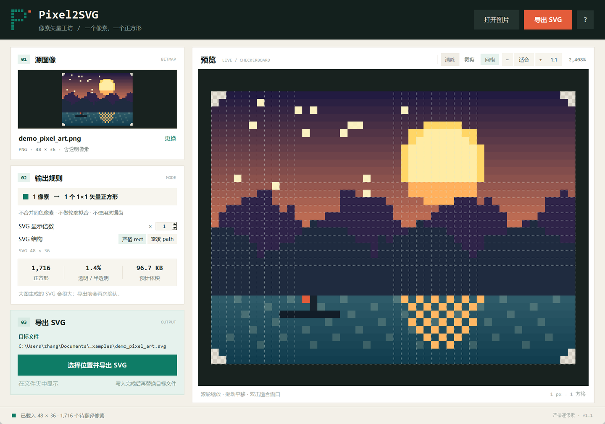
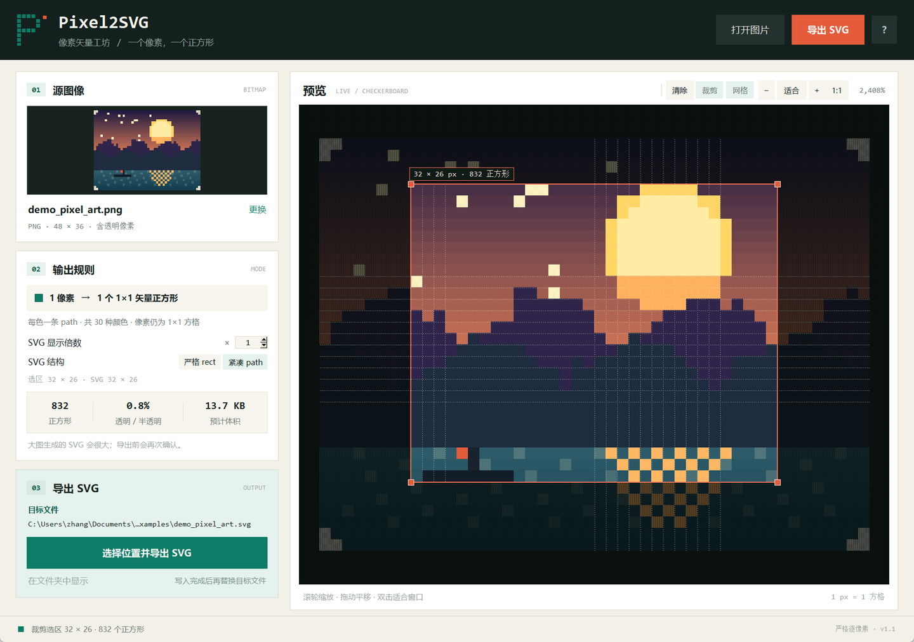

# Pixel2SVG · 像素矢量工坊

把一张位图**逐像素**翻译成 SVG：每个不透明或半透明像素，都会变成一个独立的
`1×1` 矢量正方形。不做轮廓拟合，不做颜色聚类，不合并同色像素。

这是它和市面上大多数“位图转矢量”工具最根本的区别：那些工具试图猜测出一组
光滑曲线，而 Pixel2SVG 只做一件事——把像素网格原样保存成矢量格式。



## 功能

- **严格逐像素**：一个像素 = 一个 `<rect width="1" height="1">`，相邻同色像素也不合并
- **裁剪选区**：在预览区拖出局部区域，直接导出该区域，适合大图取图和精灵提取
- **可选紧凑 path**：默认仍是严格 rect；切换到紧凑模式后，每种 RGBA 颜色一条
  `<path>`，每条路径仍由多个 `1×1` 正方形子路径组成。示例图从 95.6 KB 降到 24.5 KB
- **保留透明度**：`alpha = 0` 的像素不生成图形；`1 ≤ alpha < 255` 的像素使用
  `fill-opacity` 精确保留透明度
- **常见格式**：PNG、JPEG、BMP、GIF、WebP、TIFF（Windows 内置 WIC 解码）
- **更多格式**：安装 Pillow 后支持 ICO、TGA、PPM/PGM/PBM、PCX、DDS 等
- **像素级预览**：棋盘格透明背景、滚轮缩放、拖动平移、1:1 查看、可选像素网格
- **可调显示尺寸**：SVG 内部仍是 1:1 像素坐标，只改变根节点的显示宽高
- **安全导出**：后台线程生成，显示进度、可取消；先写临时文件，成功后再原子替换
- **无需安装第三方库也能在 Windows 上运行**：自动回退到系统 WIC 解码器

## 快速开始

要求 Python 3.10+，并且 Python 自带 Tkinter。

### Windows 双击运行

双击 **`启动 Pixel2SVG.bat`**。它会优先使用 `pythonw`，不显示黑色控制台窗口。

也可以直接双击 `Pixel2SVG.pyw`。

### 命令行运行

```powershell
python pixel2svg.py
python pixel2svg.py examples/demo_pixel_art.png
```

打开后点击左侧“源图像”区域选择图片；拖入文件暂不支持，点击即可。
`Ctrl+O` 同样可以打开文件。

### 可选：安装 Pillow

Windows 上不装 Pillow 也能使用。安装后支持更多格式，预览的缩放也会更快、
更平滑：

```powershell
python -m pip install -r requirements.txt
```

macOS / Linux 上请安装 Pillow：

```bash
python3 -m pip install Pillow
```

## 输入格式

| 解码器 | 说明 |
| --- | --- |
| Windows WIC（默认回退） | PNG、JPEG/JFIF、BMP、GIF、WebP、TIFF；不需要安装任何东西（WebP 取决于系统编解码器） |
| Pillow（如果已安装） | 上述格式 + ICO、TGA、PPM/PGM/PBM、PCX、DDS 等 Pillow 支持的格式 |

补充说明：

- 动图（GIF/WebP）只取**第一帧**，界面会显示“取第 1 帧”
- JPEG / PNG / TIFF 的 EXIF 方向会被自动应用，手机竖拍照片不会横过来
- 默认保留原始 alpha；透明区域在 SVG 中保持透明
- 不做 ICC 色彩管理：颜色按解码后的 RGB 数值写入，追求的是像素值本身
- CMYK JPEG 的 CMYK→RGB 结果由解码器决定，WIC 与 Pillow 可能略有差异；对颜色有严格要求时，建议先转换为 sRGB PNG

## 使用说明

1. 点击源图像区域，选择一张位图。
2. 在预览区检查透明区域和像素网格；可用工具栏缩放。
3. 如需局部导出，点工具栏的 **裁剪**，在预览中左键拖出选区；裁剪模式中可用
   右键拖动平移画布。点 **清除** 恢复整图。
4. 在“输出规则”中设置 **SVG 显示倍数**（1–100）和 **SVG 结构**：
   **严格 rect** 或 **紧凑 path**。显示倍数只改变 SVG 根节点的显示宽高，
   坐标仍是 1 像素 = 1 单位。
5. 点击“选择位置并导出 SVG”。
6. 导出完成后，可以点“在文件夹中显示”。

当待翻译像素超过 **250,000** 个时，程序会先提示预计文件大小，再决定是否继续。

### 快捷键

| 快捷键 | 功能 |
| --- | --- |
| `Ctrl+O` | 打开图片 |
| `Ctrl+S` | 导出 SVG |
| `Ctrl+0` | 适合窗口 |
| `Ctrl+1` | 1:1 显示 |
| 鼠标滚轮 | 以指针为中心缩放 |
| 拖动预览 | 平移画布 |
| 裁剪模式右键拖动 | 平移画布（左键用于选区） |
| 双击预览 | 适合窗口 |
| `Esc` | 退出裁剪模式；没有裁剪模式时清除选区 |

## 导出的 SVG 长什么样

```xml
<?xml version="1.0" encoding="UTF-8"?>
<svg xmlns="http://www.w3.org/2000/svg" width="48" height="36"
     viewBox="0 0 48 36" version="1.1" shape-rendering="crispEdges">
  <title>demo.png · 像素矢量</title>
  <desc>Pixel2SVG 严格逐像素转换：1716 个不透明或半透明像素……</desc>
  <g id="pixels">
    <rect x="0" y="0" width="1" height="1" fill="#ff0000"/>
    <rect x="1" y="0" width="1" height="1" fill="#00ff00" fill-opacity="0.501961"/>
    <rect x="3" y="2" width="1" height="1" fill="#0000ff"/>
  </g>
</svg>
```

- 每个矩形都固定在整数像素网格上，`width` 与 `height` 都是 `1`
- 根节点使用 `viewBox="0 0 宽 高"` 与 `shape-rendering="crispEdges"`，
  放大查看时不会因为抗锯齿产生模糊边
- 完全透明的像素不写 `<rect>`，所以透明区域在 SVG 里仍是透明的
- `fill-opacity` 使用最多 6 位小数（去掉尾零），8 位 alpha 值可以精确还原

## 裁剪与紧凑模式

### 裁剪导出

点工具栏的 **裁剪**，在预览中按住左键拖出区域：

- 选区吸附到整数像素网格，并显示宽高和正方形数量
- 选区外会压暗，方便确认
- 导出时只写选区，坐标归一化到 `0,0`，SVG 的 `viewBox` 也变成选区尺寸
- 裁剪模式中左键拖选区、右键拖动画布；**清除** 恢复整图
- `Esc` 先退出裁剪模式，再按一次清除选区



### 紧凑 path

默认的“严格 rect”保持一个像素一个 `<rect>`。切到“紧凑 path”后，程序按
**完全相同的 RGBA 颜色**分组，每种颜色写一条 `<path>`：

```xml
<svg ... data-pixel-mode="compact">
  <g id="pixels">
    <path fill="#e45c3a" d="M0 0h1v1h-1zM1 0h1v1h-1z"/>
    <path fill="#00ff00" fill-opacity="0.501961"
          d="M2 1h1v1h-1z"/>
  </g>
</svg>
```

- 每个 `M…h1v1h-1z` 仍然是一个 `1×1` 正方形，没有把相邻像素合并成大方块
- 颜色分组只影响 XML 结构，视觉结果与严格模式相同
- 示例图：严格模式 95.6 KB，紧凑模式 24.5 KB
- 颜色超过 **2048** 种时会拒绝紧凑模式，提示改用严格 rect；照片通常属于这种情况
- 大面积少色像素画、图标、精灵表最适合紧凑模式

示例文件：[严格 rect](examples/demo_pixel_art.svg) ·
[紧凑 path](examples/demo_pixel_art_compact.svg)

## 文件体积

严格逐像素意味着矩形数量 = 非全透明像素数量，文件会比“合并色块/曲线拟合”的
SVG 大很多。导出一千万像素的照片会生成数亿字符，**请先用小图或像素画测试**。

大致估算（全不透明图片、每像素一个矩形）：

| 图片尺寸 | 矩形数 | SVG 大约体积 |
| ---: | ---: | ---: |
| 100 × 100 | 10,000 | 0.6 MB |
| 256 × 256 | 65,536 | 3.7 MB |
| 500 × 500 | 250,000 | 14 MB |
| 1000 × 1000 | 1,000,000 | 57 MB |
| 2000 × 2000 | 4,000,000 | 230 MB |

这是这种“像素级保真”方式的固有代价。SVG 是文本格式，gzip 之后会小很多，但
文件本身的节点数量不会减少。

## 命令行模式（无界面）

适合批量处理或自动化测试：

```powershell
python pixel2svg.py 输入.png --export 输出.svg
python pixel2svg.py 输入.png --export 输出.svg --scale 2
python pixel2svg.py 输入.png --export 输出.svg --mode compact
python pixel2svg.py 输入.png --export 输出.svg --backend wic
```

- `--scale`：SVG 显示倍数，1–100
- `--mode`：`strict`（默认，每像素一个 rect）/ `compact`（每色一条 path）
- `--backend`：`auto`（默认）/ `pillow` / `wic`

## 项目结构

```text
.
├── pixel2svg.py           # 入口：GUI 启动 + 命令行导出
├── pixel2svg_gui.py       # Tkinter 界面、裁剪、预览、缩放、导出进度
├── pixel2svg_core.py      # 图像解码、WIC 回退、裁剪、SVG 生成、预览渲染
├── Pixel2SVG.pyw          # 无控制台窗口启动器
├── 启动 Pixel2SVG.bat     # Windows 双击启动
├── requirements.txt       # 可选依赖 Pillow
├── LICENSE                # MIT License
├── examples/
│   ├── demo_pixel_art.png         # 带透明度的示例图片
│   ├── demo_pixel_art.svg         # 严格 rect 输出
│   └── demo_pixel_art_compact.svg # 紧凑 path 输出
├── docs/
│   ├── screenshot.png      # 界面截图
│   └── screenshot-crop.png # 裁剪选区截图
└── tests/test_core.py     # 核心行为测试
```

## 测试

```powershell
python -m unittest discover -s tests -v
# 如果本机有 Pillow，再用带 Pillow 的 Python 跑一遍，覆盖两套解码路径
```

测试覆盖：每像素一个矩形、同色像素不合并、透明度、alpha 精度、从严格/紧凑 SVG
逐像素还原、裁剪区域、颜色上限、显示倍数、取消导出、预览 PPM 尺寸、
PNG/JPEG/TIFF EXIF 方向，以及 Pillow 与 WIC 解码结果一致性等。

## 已知限制

- 严格逐像素，因此大图生成的 SVG 很大；这是设计目标，不是 bug
- 紧凑模式只是减少 XML 节点，不能改变“每个像素仍需一个正方形”的信息量
- 颜色超过 2048 种时紧凑模式会拒绝导出，以免文件反而更大
- 动图只取第一帧
- 不合并同色像素、不做轮廓拟合、不做抗锯齿
- 不写入 ICC 配置文件，也不做色彩空间转换
- 未安装 Pillow 的 Windows 环境依赖系统 WIC；个别格式（如 TGA）需要 Pillow
- 未安装 Pillow 时，带 EXIF 旋转的大图（如 12MP JPEG）会多花约 2–3 秒做纯 Python 旋转，但界面不会冻结
- 预览是叠加棋盘格的位图；导出的 SVG 才是真正的矢量文件

## License

本项目采用 **MIT License**，详见 [LICENSE](LICENSE)。

Copyright (c) 2026 xxzh-code
